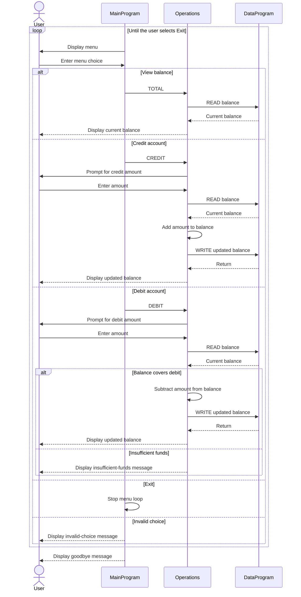

# COBOL Account Management

This directory contains documentation for the COBOL account-management example in `src/cobol/`. The program operates on one generic account balance; it does not currently model student records or student-specific account types.

## Source Files

- [`main.cob`](../src/cobol/main.cob) — The `MainProgram` entry point displays the account menu, accepts a choice, and dispatches view, credit, and debit requests to `Operations`. Choosing 4 exits the program; other unrecognized choices display an error message.
- [`operations.cob`](../src/cobol/operations.cob) — The `Operations` program implements the account actions. It dispatches on the passed operation value: `TOTAL` reads and displays the balance, `CREDIT` accepts an amount and adds it, and `DEBIT` accepts an amount and subtracts it when funds are sufficient. It calls `DataProgram` to read or save the balance.
- [`data.cob`](../src/cobol/data.cob) — The `DataProgram` module provides `READ` and `WRITE` operations for the balance. Its working-storage balance is initialized to `1000.00`; the value is held in program memory rather than stored in a file or database.

## Business Rules

- The account starts with a balance of `1000.00`.
- A credit adds the entered amount to the balance.
- A debit is applied only when the current balance is greater than or equal to the entered amount. Otherwise, the program displays an insufficient-funds message and leaves the balance unchanged.
- The code defines no maximum balance, fees, student eligibility checks, student identifiers, or separate balances per student.
- No student-specific business rules are implemented in these files; the current rules apply to one generic account.

## Sequence Diagram

